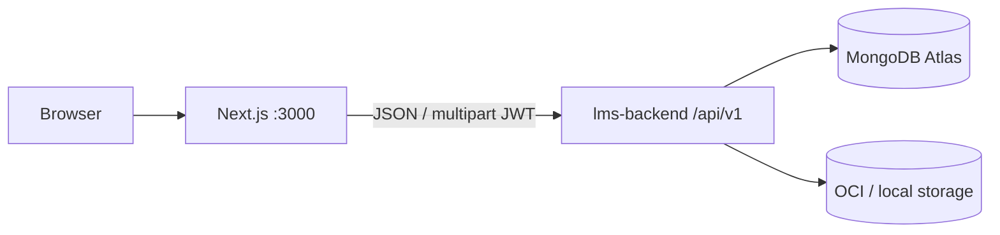

# Loan Management System — Frontend

UI for the **Full-Stack LMS Assignment** (MERN · Next.js · TypeScript).

Two surfaces:

1. **Borrower portal** — multi-step application (auth → personal details + BRE → salary slip → loan config & apply)  
2. **Operations dashboard** — Sales, Sanction, Disbursement, Collection (role-guarded; Admin sees all)

Backend: sibling repo **`lms-backend`**.

| | |
|--|--|
| **App** | https://creditsea.duckdns.org |
| **API** | https://creditsea.duckdns.org/api/v1 |
| **Health** | https://creditsea.duckdns.org/api/v1/health |

> **Test on production:** Use the seeded accounts below — password: `Password123!` — already in the live DB.

---

## Further reading

| Doc | Description |
|-----|-------------|
| **`lms-backend` README** | API setup, seed credentials, assignment map |
| **`lms-backend/docs/DEPLOYMENT.md`** | Production deploy — Oracle VM, Nginx, PM2, GitHub Actions |
| **`lms-backend/docs/ARCHITECTURE.md`** | System design — layers, auth/RBAC, lifecycle, storage |

---

## Tech stack

| Layer | Choice |
|-------|--------|
| Framework | Next.js (App Router) + TypeScript |
| Styling | Tailwind CSS |
| Auth | JWT in the browser; `AuthGuard` by role |
| API | REST against `lms-backend` (`/api/v1`) |



---

## Setup

### Prerequisites

- Node.js 20+
- Running **lms-backend** on `http://localhost:4000` with `npm run seed` completed

### Install and run

```bash
git clone https://github.com/chaitanya07422/lms-backend.git
git clone https://github.com/chaitanya07422/lms-frontend.git

cd lms-frontend
cp .env.example .env.local
npm install
npm run dev
```

App: **http://localhost:3000**

Edit `.env.local` before starting. See [`.env.example`](./.env.example).

### Environment

| Variable | Purpose | Local default |
|----------|---------|---------------|
| `NEXT_PUBLIC_API_BASE_URL` | Backend base including `/api/v1` | `http://localhost:4000/api/v1` |
| `NEXT_PUBLIC_APP_NAME` | Product label in UI | `CreditSea` |
| `NEXT_PUBLIC_POSTHOG_KEY` | Optional PostHog project API key | unset = analytics off |
| `NEXT_PUBLIC_POSTHOG_HOST` | PostHog ingest host (or `/ingest` proxy) | `/ingest` |
| `NEXT_PUBLIC_POSTHOG_UI_HOST` | PostHog app UI host | `https://us.posthog.com` |

Backend `CORS_ORIGIN` must include `http://localhost:3000`.

**PostHog:** set `NEXT_PUBLIC_POSTHOG_KEY` from your PostHog project settings. Events go through the Next.js `/ingest` rewrite (less likely blocked). Users are identified on login/register and reset on logout.

### Scripts

| Script | Purpose |
|--------|---------|
| `npm run dev` | Dev server (hot reload) |
| `npm run lint` | ESLint |
| `npm run typecheck` | TypeScript check |
| `npm run build` | Production build |

---

## Login credentials (from backend seed)

Password for **all** accounts below:

```text
Password123!
```

| Role | Email | UI access |
|------|-------|-----------|
| Admin | `admin@creditsea.local` | All dashboard modules |
| Sales | `sales@creditsea.local` | Sales only |
| Sanction | `sanction@creditsea.local` | Sanction only |
| Disbursement | `disbursement@creditsea.local` | Disbursement only |
| Collection | `collection@creditsea.local` | Collection only |
| Borrower | `borrower@creditsea.local` | Borrower portal only |

For local setup, run `npm run seed` once in **lms-backend**. New borrowers can also **Sign up** from the login page.

---

## What the UI implements (assignment map)

### Borrower journey

| Step | Route / screen | Behaviour |
|------|----------------|-----------|
| 1. Auth | `/login` | Sign up / login; other pages protected |
| 2. Personal details | `/borrower/profile` | Name, PAN, DOB, salary, employment; **server BRE** |
| 3. Salary slip | `/borrower/salary-slip` | PDF / JPG / PNG ≤ 5 MB |
| 4. Apply | `/borrower/apply` | Amount ₹50k–₹5L & tenure 30–365 day sliders; live SI quote at 12% p.a.; Apply → **APPLIED** |

**BRE fail demo:** age outside 23–50, salary under ₹25,000, invalid PAN, or employment = Unemployed.  
**BRE pass:** fix those fields, then continue to slip + apply.

Account home / loan detail show repayment progress and payment history (payments are recorded by Collection).

### Operations dashboard

| Module | Who | Actions |
|--------|-----|---------|
| **Sales** | sales, admin | Leads — registered users who have not applied |
| **Sanction** | sanction, admin | Approve or reject (with reason) APPLIED loans |
| **Disbursement** | disbursement, admin | Mark SANCTIONED loans as DISBURSED |
| **Collection** | collection, admin | Record UTR + amount + date; loan **auto-closes** at zero balance |
| **Overview / Users** | admin | Stats, activity, create staff users |

Each executive role sees **only** their module. Admin sees **all**. Borrowers cannot open the dashboard.

Access is enforced in the UI (`AuthGuard`) **and** on the API — hiding a nav item is not enough.

### Loan lifecycle

```text
APPLIED → SANCTIONED → DISBURSED → CLOSED
       ↘ REJECTED
```

---

## Suggested evaluator walkthrough

Matches the assignment demo video flow (3–5 min):

1. **Borrower** — register or use `borrower@creditsea.local`  
2. Enter details that **fail BRE** → see clear errors  
3. Fix details so BRE **passes** → upload salary slip → configure loan → Apply  
4. **Sanction** (`sanction@creditsea.local`) — approve the loan  
5. **Disbursement** (`disbursement@creditsea.local`) — mark disbursed  
6. **Collection** (`collection@creditsea.local`) — record payment(s) with unique UTR until outstanding is ₹0 → status **CLOSED**  
7. Optionally show **Sales** leads and that a **sales** user cannot open Sanction routes  

---

## Production

| | |
|--|--|
| App | https://creditsea.duckdns.org |
| API | https://creditsea.duckdns.org/api/v1 |
| Health | https://creditsea.duckdns.org/api/v1/health |

Same Oracle Cloud host as the API: Nginx (TLS) → Next.js PM2 `lms-web` on `:3000`; `/api/` → backend `:4000`.

Deploy details → **`lms-backend/docs/DEPLOYMENT.md`**.

---

## Project layout

```text
lms-frontend/
├── src/app/
│   ├── login/                 # Auth
│   ├── borrower/              # Portal (profile, slip, apply, loans)
│   └── dashboard/             # Ops (sales, sanction, disbursement, collection, admin)
├── src/components/            # Shared UI + AuthGuard
├── src/lib/                   # API clients, money, roles
├── .env.example
└── package.json
```
